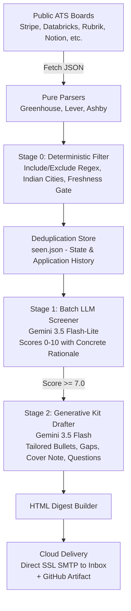

<div align="center">

#  ScoutAI

### Autonomous, LLM-Powered Career Search & Application Agent

An end-to-end autonomous pipeline that monitors public ATS APIs every morning, filters out 99% of irrelevant listings, screens survivors against your student profile using Gemini models, drafts tailored application kits for top matches, and delivers an email digest straight to your inbox.

[](https://github.com/uttamsengar21/ScoutAI/actions/workflows/daily.yml)
[](tests/)
[](https://www.python.org/)
[](LICENSE)

```
3,000 Live Postings  →  15 Verified Candidates  →  1–3 Curated Digest Matches
      Fetch                 Deterministic Gate             Two-Stage LLM Cascade
   Official APIs            Title / City / Freshness      Screening (Flash-Lite)
 (Greenhouse/Lever/Ashby)        (0 Token Cost)           + Generative Drafting (Flash)
```

</div>

---

##  What is ScoutAI?

Most applicants spend 1–2 hours daily sifting through generic job boards, outdated postings, and recruiter spam. **ScoutAI automates this entire discovery and evaluation cycle.**

It acts as an autonomous personal recruiter:
- **Never scrapes illegally**: Connects directly to official, public ATS JSON endpoints (Greenhouse, Lever, Ashby).
- **Never sends blind applications**: It finds, filters, scores, and drafts. A human reads the digest, edits the tailored kit, and applies directly.
- **Tuned for university students & early career**: Context-aware prompts evaluate genuine student potential without penalizing candidates for having zero years of full-time industry experience.
- **Automated CI/CD**: Runs every weekday morning at **08:30 AM IST** via GitHub Actions with zero local infrastructure needed.

---

##  Architecture & AI Engineering



### 1. Two-Stage Cascaded LLM Inference
Passing thousands of raw job postings to an LLM is slow, cost-prohibitive, and hits rate limits. ScoutAI employs a **hierarchical filtering cascade**:
1. **Deterministic Gate (Cost: $0.00)**: Prunes 98%+ of listings using compiled regular expressions, geolocation boundaries, and publication timestamps.
2. **Cheap Batch Screener (`gemini-3.5-flash-lite`)**: Packs 8 job descriptions per prompt, truncated to high-signal portions, to evaluate alignment and output strict structured JSON.
3. **Deep Generative Drafter (`gemini-3.5-flash`)**: High-capacity model only invoked for candidates scoring $\ge 7.0$ to produce tailored interview kits.

### 2. Guarded Context & Student-Centric Evaluation
Traditional screeners fail students because prompt criteria often penalize zero years of industry experience. ScoutAI's system prompt:
- Injects a structured `profile.json` (education, CGPA, graduation timeline, MERN projects, DSA metrics).
- Explicitly enforces that internships and new-grad roles are **not** seniority mismatches.
- Distinguishes "zero industry experience" from "zero technical ability" by validating project complexity and problem-solving background.
- Strictly penalizes foreign-restricted work authorizations (e.g. US/UK/Ireland-only postings) to avoid wasted outreach.

### 3. Tolerant JSON Recovery
Handles LLM output quirks (markdown fences ````json````, conversational preambles, trailing commentary, or array/object wrapping) via resilient bracket-scanning parsers with fallback recovery.

---

##  Project Structure

```
ScoutAI/
├── .github/workflows/
│   └── daily.yml        # Cloud CI/CD scheduler (08:30 AM IST cron + cache)
├── scoutai/
│   ├── fetch.py         # Pure ATS adapters (Greenhouse, Lever, Ashby)
│   ├── prefilter.py     # Deterministic regex, country-restricted remote & date filters
│   ├── store.py         # Deduplication index, re-evaluation logic, tracker & CSV exporter
│   ├── llm.py           # Two-stage screening & drafting + tolerant JSON parser
│   ├── providers.py     # Multi-backend LLM client (Gemini, Claude, Groq, Ollama)
│   ├── digest.py        # Dark-mode inline HTML email generator
│   ├── mailer.py        # SMTP client with direct SSL (port 465) and STARTTLS fallback
│   ├── mock.py          # Offline native-shape ATS fixtures for testing
│   └── cli.py           # CLI interface (run, profile, applied, stats)
├── tests/
│   ├── test_parsers.py  # 70+ parser, prefilter, and deduplication tests
│   └── test_llm.py      # 38+ tolerant parsing, batching, and screening tests
├── companies.yaml       # 16 verified top engineering companies with India hubs
├── config.yaml          # Deterministic filter rules, thresholds, and limits
├── profile.example.json # Sample candidate schema
└── requirements.txt     # Minimal dependencies (requests, pyyaml, pytest)
```

---

##  Quickstart (Local)

### 1. Clone & Setup
```bash
git clone https://github.com/uttamsengar21/ScoutAI.git
cd ScoutAI

python -m venv .venv
.venv\Scripts\activate      # Windows
# source .venv/bin/activate # macOS/Linux

pip install -r requirements.txt
```

### 2. Run the Test Suite (108 Tests, 0 API Calls)
```bash
pytest tests/ -v
```
Runs 108 unit tests in under a second with zero network dependency.

### 3. Run Offline Mock Pipeline
```bash
python -m scoutai run --mock --scorer keyword
```
Runs bundled native ATS fixtures through the real parsers, deduplication engine, and HTML generator without requiring any API keys. Open `out/digest.html` to inspect the generated report.

---

##  Cloud Automation (GitHub Actions)

ScoutAI runs completely hands-free in the cloud every weekday at **08:30 AM IST**.

### Required Repository Secrets
In your GitHub repository, navigate to **Settings → Secrets and variables → Actions** and add:

| Secret Name | Description | Example / Format |
|---|---|---|
| `GEMINI_API_KEY` | Google AI Studio Gemini API Key | `AIzaSy...` |
| `SMTP_USER` | Gmail address sending the digest | `yourname@gmail.com` |
| `SMTP_PASS` | Google 16-character App Password | `abcd efgh ijkl mnop` |
| `MAIL_TO` | Destination inbox for the digest | `yourname@gmail.com` |
| `PROFILE_JSON` | Entire JSON content of your `profile.json` | See `profile.example.json` |

### Triggering a Manual Cloud Run
1. Go to the **Actions** tab in your repository.
2. Select **daily job digest** from the left sidebar.
3. Click **Run workflow** $\rightarrow$ **Run workflow**.

---

##  Application Tracker & CLI Commands

`seen.json` maintains the state of discovered, screened, and applied jobs so you are never shown duplicates.

```powershell
# Run regular daily scan
python -m scoutai run

# Send email upon completion
python -m scoutai run --send

# Re-evaluate previously seen jobs against updated filters
python -m scoutai run --rescreen

# Mark a job as applied after submitting
python -m scoutai applied "greenhouse:stripe:8031833"

# View funnel stats and generate an updated CSV tracker
python -m scoutai stats
```

The CSV tracker is exported to `out/tracker.csv`, readable by Excel, Google Sheets, or Numbers.

---

##  Security & Privacy

- **No Scraping**: Only queries public career APIs intended for public indexing.
- **Zero Credentials in Git**: `.env`, `seen.json`, `profile.json`, and generated outputs are strictly gitignored.
- **No Secret Leaking**: SMTP error handlers redact credentials and passwords from logs.
- **Stateless CI/CD**: Cloud runners restore `seen.json` through encrypted repository action caches.

---

## 📄 License

Distributed under the MIT License. See [LICENSE](LICENSE) for details.
